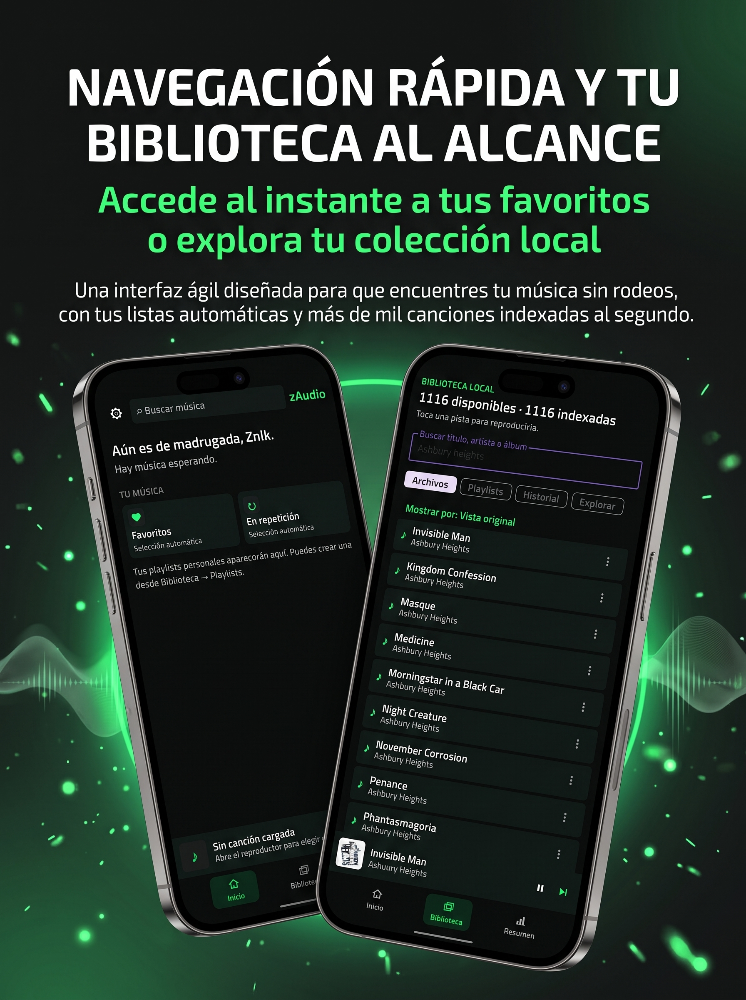
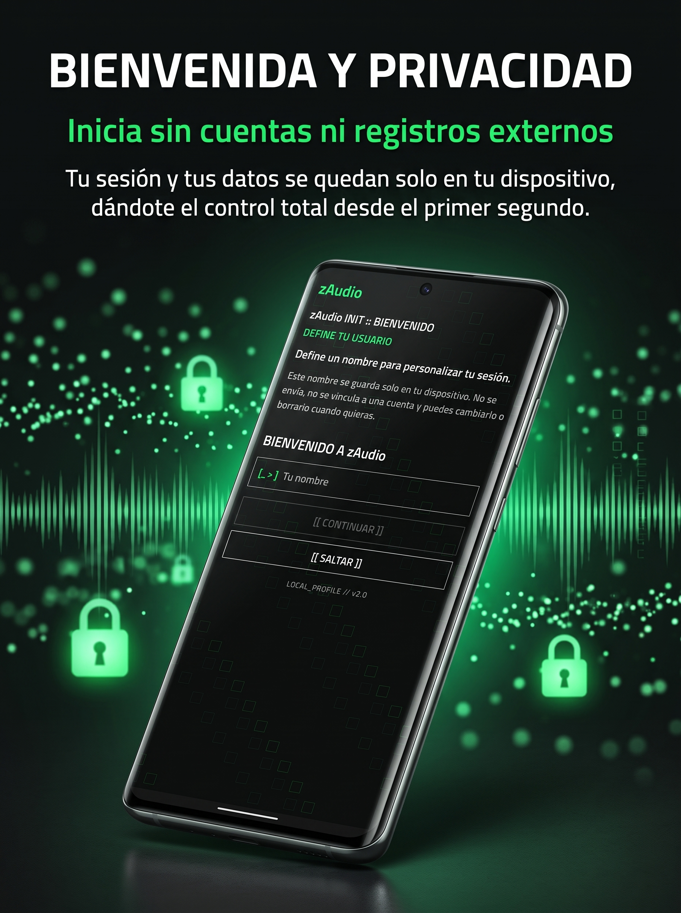
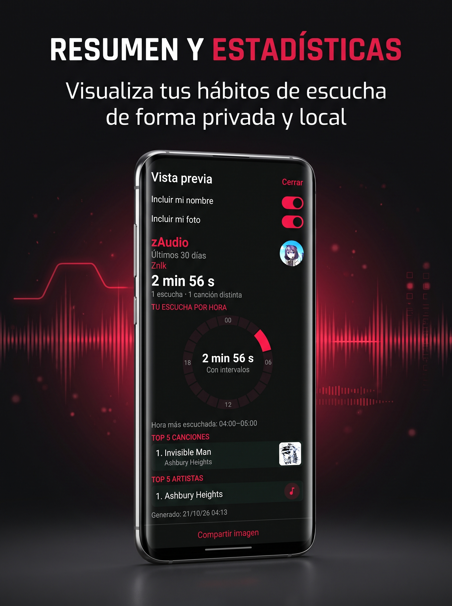
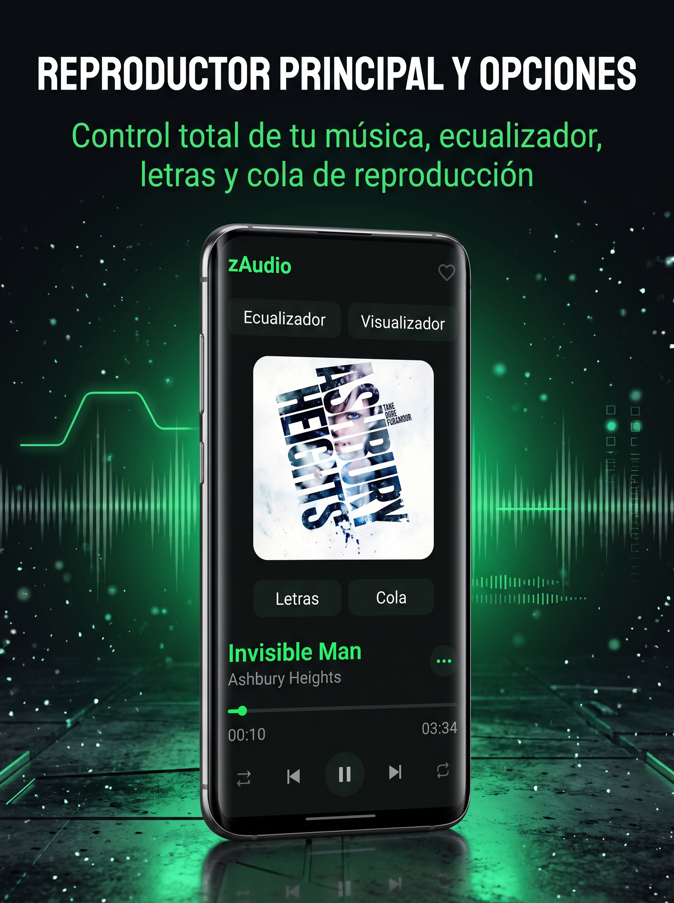
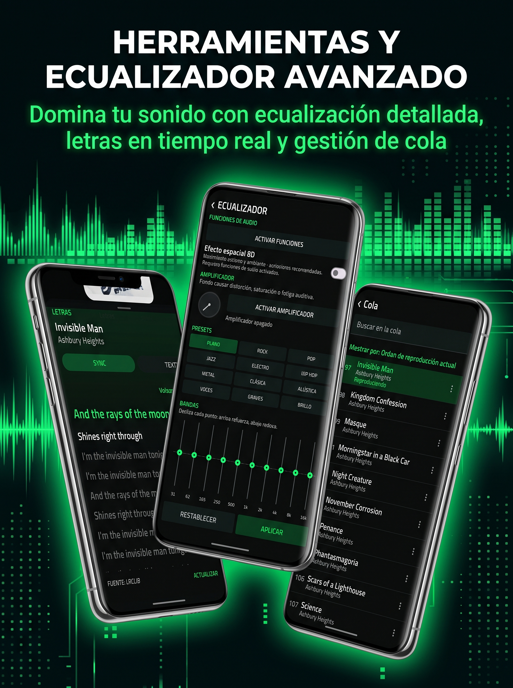
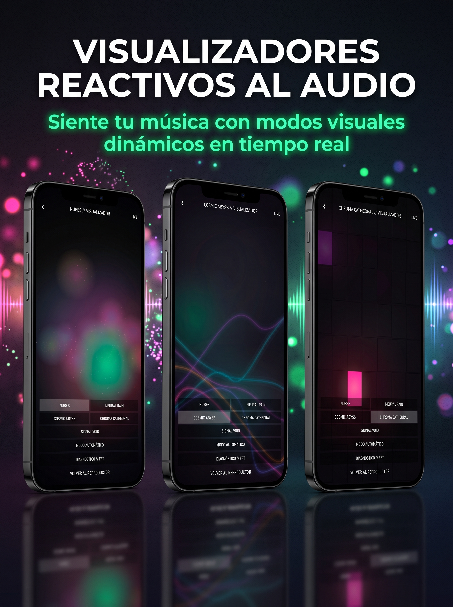
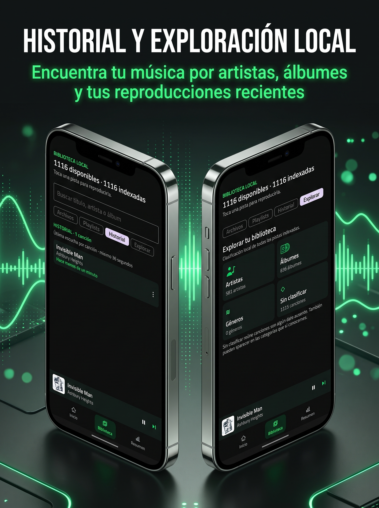

# 🎵 zAudio

**Reproductor de música local para Android**

Gratuito · Sin anuncios · Sin compras · Sin muros de pago

---

## ✨ Características

| | |
|---|---|
| 🎶 **Reproducción local** | Cola de reproducción, reproducción continua y control total de tu biblioteca |
| 🎚️ **Ecualizador** | 10 bandas, presets y amplificador integrado |
| 📝 **Letras** | Sincronizadas y planas, con búsqueda por tiempo |
| 🌈 **Visualizador** | Espectrograma y visualizador avanzado de audio |
| 🎚️ **Crossfade y 8D** | Transiciones suaves y efecto espacial |
| 📚 **Biblioteca** | Playlists, favoritos, historial y exploración por artista/álbum/género |
| 🎨 **Personalización** | Modo oscuro/claro y colores de acento |

## 📱 Capturas

  
  
  
   
  
  
  
   
  

## 📥 Descargar

**[⬇️ Descargar zAudio v1.0-beta](https://github.com/lyak01/zaudio/releases/latest)**

APK firmado · 11.85 MB · Android 8.0+

## 📋 Requisitos

- Android 8.0 (API 26) o superior
- Permisos de acceso a archivos de audio

## 📄 Licencia y distribución

zAudio se distribuye como **APK gratuito**, sin anuncios, compras dentro de la app ni muros de pago.

- ✅ Puedes descargarlo, usarlo y compartirlo libremente
- ✅ El APK puede ser auditado libremente
- ❌ No está permitido vender el APK ni presentarlo como producto propio
- 💝 Las donaciones son **completamente opcionales** y no desbloquean nada

## 💝 Apoya el proyecto

Si te gusta zAudio y quieres contribuir a su desarrollo:

**[☕ Donar con PayPal](https://paypal.me/lyakainthavehope)**

*La app es y será siempre 100% gratuita para todos.*

## 🐛 Reportar problemas o sugerir funciones

Abre un [Issue](https://github.com/lyak01/zaudio/issues) en este repositorio.

---

*Hecho con ❤️ para los amantes de la música local*

